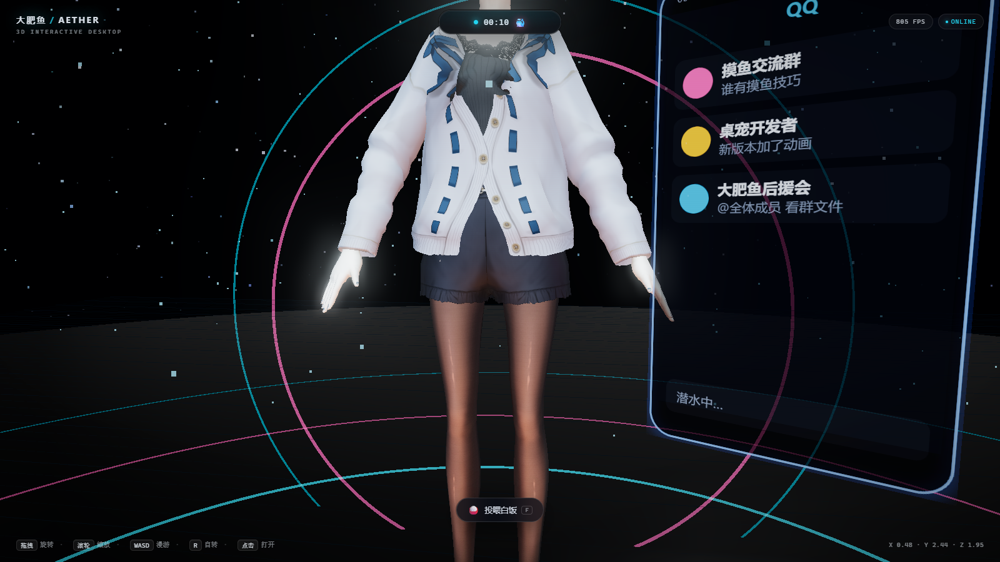

# 蓝色大肥鱼 · AETHER 3D DESKTOP

一个跑在浏览器里的 **3D 交互式桌面**：星空、金属地面、霓虹应用坞、会呼吸的 **灵动岛**，
以及一个**真正会「过日子」的 3D 骨骼角色**——蓝色大肥鱼。





---

## 自主生活系统

角色不只会站着待机，她有自己的作息和活动，会自己找事做：

| 活动 | 表现 |
|---|---|
| 📱 **刷抖音** | 全息屏播放模拟信息流，点赞数随时间上涨、进度条走格、评论滚动 |
| 💬 **回微信** | 聊天列表实时刷新，新消息顶上来，输入框光标闪烁 |
| 🐧 **挂 QQ** | 群列表滚动，@全体成员、群文件这些细节都在 |
| 🌐 **上网冲浪** | 模拟浏览器：地址栏、热搜列表、内容自动滚动 |
| 💤 **发呆** | 屏幕收起，露出 Zzz 动画 |

驱动方式：

- **加权随机状态机**：每个活动有权重（刷抖音最高）与随机时长，避免连续重复
- **全息屏**：一块跟随相机朝向的 CanvasTexture 面板，12fps 重绘模拟内容
- **动作联动**：进入需要屏幕的活动时，角色抬起右前臂做「举手机」姿势，头部微低
- **台词联动**：每次切换活动说一句对应台词（气泡跟随头顶投影）
- **灵动岛联动**：副标题实时显示「正在刷抖音」「正在回微信」

> **关于真实社交**：屏幕内容是**模拟渲染**，不会真的抓取或操作抖音 / 微信 / QQ。
> 真实接入需要独立 bot 后端与真实账号（见下方「如何真正接入社交软件」）。

---

## 角色：真 3D 骨骼模型

角色躯干使用 VRoid 官方示例模型 `AvatarSample_A`（VRM 0.x，25.5 MB，95 节点 / 54 根人形骨骼），
由 `@pixiv/three-vrm` 解析、`three.js` 渲染。

| 处理 | 做法 |
|---|---|
| 染发 | HAIR 材质基色替换为鲸鱼蓝 |
| 眼睛 | 虹膜材质改为亮蓝 |
| 材质 | MToon → `MeshStandardMaterial`，解决面部发黑并统一光照 |
| 描边 | 保留 inverted-hull 描边壳，改为半透明深蓝 |
| 姿势 | 通过 VRM 归一化骨骼把 T-pose 摆成自然垂手站姿 |

**骨骼驱动**：呼吸（胸腔起伏）、站立微摆、看向鼠标、随机眨眼（expression `blink`）、
点击跳跃点头、举手机。

---

## 其他特性

### 3D 桌面
Three.js + WebGL 2，ACES Filmic 色调映射；星空粒子、悬浮尘埃、金属反射地面、多层发光环；
6 个应用图标弧形悬浮，各有独立霓虹描边；UnrealBloom 泛光后处理。

### 自由交互
- 拖拽旋转 / 滚轮缩放 / 右键平移（OrbitControls + 阻尼）
- **WASD** 水平漫游、**Q/E** 升降、**R** 自动旋转
- 悬停图标：抬升、放大、描边增亮，灵动岛同步显示应用名

### 灵动岛
四种形态平滑形变（宽度、高度、圆角同步过渡）：紧凑 / 悬停 / 通知 / 展开。
展开态含迷你播放器、频谱动画、FPS 与算力。

### 陪伴系统
对话气泡、投喂白饭（`F`）、算力消耗与告急、空闲主动搭话。

---

## 快速开始

```bash
npm install
npm run dev        # http://127.0.0.1:5273
npm run build      # 产物在 dist/
npm run preview    # http://127.0.0.1:5274
```

### 演示模式

```
/?demo=1   # 展开音乐面板 + 灵动岛
/?demo=2   # 角色 + 对话气泡
/?demo=3   # 斜视角
/?demo=4   # 角色特写
```

### 截图工具

VRM 有 25 MB，`--virtual-time-budget` 会在异步解析完成前就截图（表现为「卡在 99%」）。
`tools/shot.mjs` 用 Puppeteer 等待条件成立再截图：

```bash
node tools/shot.mjs "http://127.0.0.1:5274/" out.png "window.__FISH_READY__ === true" 120000 1600 900
```

---

## 操作一览

| 操作 | 效果 |
|---|---|
| 左键拖拽 | 旋转视角 |
| 滚轮 | 缩放远近 |
| 右键拖拽 | 平移场景 |
| `W` `A` `S` `D` | 水平漫游 |
| `Q` / `E` | 上升 / 下降 |
| `R` | 开 / 关自动旋转 |
| `F` | 投喂白饭 |
| `Esc` | 关闭面板与灵动岛 |

---

## 如何真正接入社交软件

浏览器里做不到，必须走独立后端。社区已有成熟方案：

| 目标 | 方案 | 说明 |
|---|---|---|
| **QQ** | [NapCatQQ](https://github.com/NapNeko/NapCatQQ) + [AstrBot](https://github.com/AstrBotDevs/AstrBot) | OneBot 协议，扫码登录，支持群聊与私聊 |
| **微信** | 企业微信 / 个人号 hook（有封号风险） | 需谨慎，官方无开放协议 |
| **抖音** | 无开放 API，只能靠浏览器自动化（Playwright）读取公开页面 | 登录态与风控是主要障碍 |

参考实现：
- [SAKURAfan1023/dafeiyu-bot](https://github.com/SAKURAfan1023/dafeiyu-bot) — 大肥鱼 QQ AI 伙伴，QQ 可用、微信测试中
- [whyever77/dafeiyu-astrbot](https://github.com/whyever77/dafeiyu-astrbot) — AstrBot + NapCat 全家桶
- [MerZlin/dsh-pet-indesktop](https://github.com/MerZlin/dsh-pet-indesktop) — 主动陪伴、识屏、Agent 联动

本项目目前只做到**可见的生活模拟**。要接真实账号，需要另起一个后端进程，
把消息通过 WebSocket 推给这个页面——架构上可行，但涉及账号安全与平台风控，需要你确认后再做。

---

## 技术栈

| 层 | 选型 |
|---|---|
| 构建 | Vite 6 |
| 3D | Three.js r180 |
| 角色 | VRM 0.x + `@pixiv/three-vrm` 3.5 |
| 生活模拟 | 加权状态机 + CanvasTexture 全息屏 |
| 后处理 | EffectComposer + UnrealBloomPass + OutputPass |
| 截图 | puppeteer-core |

---

## 素材来源与许可

- **角色模型**：`AvatarSample_A.vrm`，作者 **VRoid Project (pixiv Inc.)**，遵循 VRoid 示例模型使用条款
- **台词风格**：[MerZlin/dsh-pet-indesktop](https://github.com/MerZlin/dsh-pet-indesktop)（MIT）的 `persona_presets/whale_maid.json`

场景、图标阵列、灵动岛、生活模拟、交互系统与全部代码均为本项目原创。

---

## 目录结构

```
.
├── index.html
├── public/models/avatar.vrm   # VRM 角色
├── tools/shot.mjs             # Puppeteer 截图
├── src
│   ├── main.js                # 场景、灯光、图标、相机、主循环
│   ├── mascot.js              # VRM 加载、材质转换、骨骼动画
│   ├── life.js                # 自主生活状态机 + 全息屏渲染
│   ├── interaction.js         # 对话气泡 / 投喂 / 算力
│   ├── island.js              # 灵动岛状态机
│   ├── panels.js              # 应用面板
│   └── style.css
└── docs
```

---

## License

MIT（代码部分）
