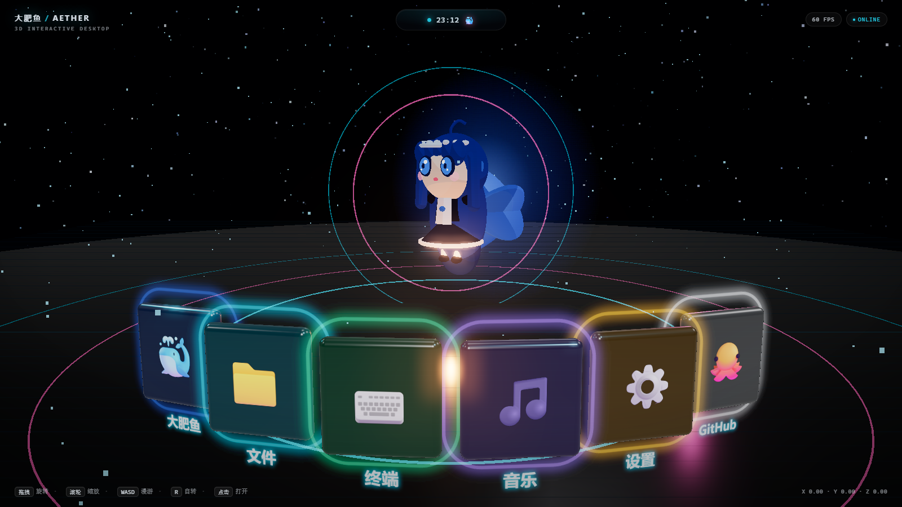
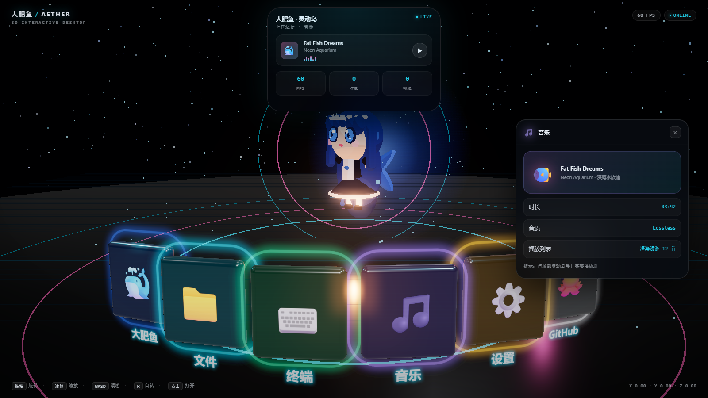

# 蓝色大肥鱼 · AETHER 3D DESKTOP

一个跑在浏览器里的 **3D 交互式桌面**：星空、玻璃地面、霓虹应用坞，外加一颗会呼吸的 **灵动岛**，
以及站在场景中央的 **蓝色大肥鱼**（DeepSeek 鲸鱼娘）。





---

## 特性

### 3D 桌面
- Three.js + WebGL 2 实时渲染，ACES Filmic 色调映射
- 星空粒子、悬浮尘埃、金属反射地面、多层发光环
- 6 个应用图标以弧形悬浮在空间中，独立的霓虹描边配色
- UnrealBloom 泛光后处理，霓虹边与图标自带辉光

### 自由交互
- **拖拽旋转 / 滚轮缩放 / 右键平移**（OrbitControls + 阻尼）
- **WASD** 水平漫游、**Q/E** 升降、**R** 切换自动旋转
- 鼠标悬停图标：抬升、放大、描边增亮，并在灵动岛显示应用名
- 点击图标：打开对应玻璃面板；点击大肥鱼：她转圈并冒出爱心

### 灵动岛
四种形态平滑形变（宽度、高度、圆角同步过渡）：

| 形态 | 触发 | 内容 |
|---|---|---|
| 紧凑 | 默认 | 呼吸光点 + 实时时钟 + 鲸鱼标识 |
| 悬停 | 鼠标移入 | 略微展开 |
| 通知 | 任意操作 | 展示操作反馈，2.4 秒后自动收回 |
| 展开 | 点击 | 迷你播放器 + 频谱动画 + 实时性能指标 |

### 大肥鱼
纯几何体程序化建模，**不依赖任何外部模型文件**：

- 蓝发 + 呆毛 + 女仆发箍 + 后垂长发
- 大号二次元眼睛（虹膜、瞳孔、双高光）、腮红、小嘴
- 浅色围裙配深色胸衣，围裙上有鲸鱼徽章
- 身后一条蓝色鲸尾，持续摆动
- 会呼吸浮动、跟着鼠标转头、随机眨眼
- 点击后转圈并冒出爱心粒子

---

## 快速开始

```bash
npm install
npm run dev        # http://127.0.0.1:5273
```

构建生产版本：

```bash
npm run build      # 产物在 dist/
npm run preview    # http://127.0.0.1:5274
```

### 演示模式

在地址后加 `?demo=1` 会自动展开音乐面板与灵动岛，方便截图与验收：

```
http://127.0.0.1:5273/?demo=1
```

---

## 操作一览

| 操作 | 效果 |
|---|---|
| 左键拖拽 | 旋转视角 |
| 滚轮 | 缩放远近 |
| 右键拖拽 | 平移场景 |
| `W` `A` `S` `D` | 水平漫游 |
| `Q` / `E` | 上升 / 下降 |
| `R` | 开 / 关自动旋转 |
| `Esc` | 关闭面板与灵动岛 |
| 点击图标 | 打开应用面板 |
| 点击大肥鱼 | 转圈 + 爱心 |

---

## 技术栈

| 层 | 选型 |
|---|---|
| 构建 | Vite 6 |
| 3D | Three.js r180 |
| 后处理 | EffectComposer + UnrealBloomPass + OutputPass |
| 环境光照 | RoomEnvironment + PMREMGenerator |
| UI | 原生 DOM + CSS（玻璃拟态、`backdrop-filter`） |

没有使用任何前端框架，全部为原生 ES Module。

---

## 关于「蓝色大肥鱼」

「大肥鱼」不是本项目原创角色，它是**网友自发为 DeepSeek 共创的拟人形象**。

起因是 DeepSeek 的品牌 logo 是一只圆润的蓝色鲸鱼，被模型误认成「蓝色大肥鱼」，
这个外号随后传开。网友在此基础上创作了鲸鱼娘形象：**蓝发、呆毛、女仆装、身后一条鲸尾**。
她那句「吃白饭」（把算力 Token 比喻成口粮）的设定，也成了社区里的流行梗。

本项目的 3D 版本是对这一社区形象的**程序化致敬**，用基础几何体还原其特征，
不包含任何官方或同人画师的原始美术素材。

---

## 目录结构

```
.
├── index.html          # 入口与全部 DOM 结构
├── src
│   ├── main.js         # 场景、灯光、图标、相机控制、主循环
│   ├── mascot.js       # 大肥鱼（鲸鱼娘）程序化建模与动画
│   ├── island.js       # 灵动岛状态机
│   ├── panels.js       # 应用定义与面板渲染
│   └── style.css       # 全部样式
└── docs                # 预览图
```

---

## License

MIT
