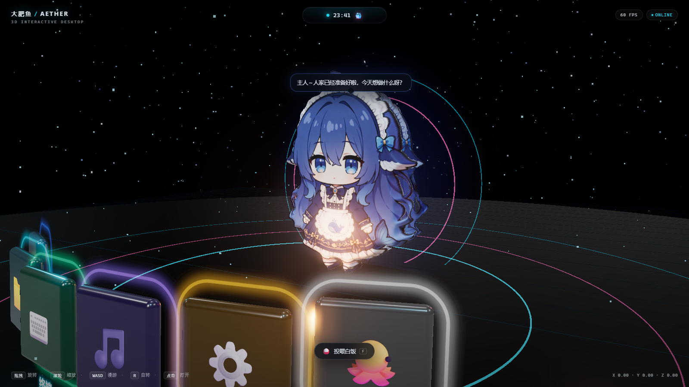

# 蓝色大肥鱼 · AETHER 3D DESKTOP

一个跑在浏览器里的 **3D 交互式桌面**：星空、金属地面、霓虹应用坞、会呼吸的 **灵动岛**，
以及站在场景中央、**有真实体积**的 **蓝色大肥鱼**（DeepSeek 鲸鱼娘）。




---

## 关于角色的 3D 化

社区里「大肥鱼」只有 2D 立绘、动画和表情包，**不存在可用的 3D 模型**
（我搜遍了 GitHub，没有任何 `.vrm / .glb / .pmx` 版本）。

所以这里没有用贴片广告牌，而是把立绘**充气成真正的三维实体**：

1. 读取立绘的 alpha 通道，做多次箱式模糊，得到一张高度场
2. 用高度场沿 Z 轴位移一张 132×176 细分的高密度网格，得到起伏的正面
3. 镜像一份作为背面，形成有厚度的实体
4. 再叠一层共用同一 alpha 遮罩的背面壳做描边

结果：**正面是原画质感，侧面有真实厚度与曲面光影**，可以绕着看，能被场景灯光照亮。
不是把图片贴在平面上，而是图片驱动生成的几何体。

---

## 特性

### 3D 桌面
- Three.js + WebGL 2，ACES Filmic 色调映射
- 星空粒子、悬浮尘埃、金属反射地面、多层发光环
- 6 个应用图标弧形悬浮，各有独立霓虹描边配色
- UnrealBloom 泛光后处理

### 自由交互
- **拖拽旋转 / 滚轮缩放 / 右键平移**（OrbitControls + 阻尼）
- **WASD** 水平漫游、**Q/E** 升降、**R** 切换自动旋转
- 悬停图标：抬升、放大、描边增亮，灵动岛同步显示应用名
- 点击图标：打开玻璃面板；点击大肥鱼：随机动作 + 台词

### 灵动岛
四种形态平滑形变（宽度、高度、圆角同步过渡）：

| 形态 | 触发 | 内容 |
|---|---|---|
| 紧凑 | 默认 | 呼吸光点 + 实时时钟 + 鲸鱼标识 |
| 悬停 | 鼠标移入 | 略微展开 |
| 通知 | 任意操作 | 展示操作反馈，2.4 秒后自动收回 |
| 展开 | 点击 | 迷你播放器 + 频谱动画 + 实时性能与算力 |

### 陪伴系统
- **对话气泡**：跟随角色头顶投影定位，台词取自社区 persona 设定
  （自称「人家」、爱撒娇、爱吃白饭 = 算力）
- **投喂白饭**：点击按钮或按 `F`，算力 +18、好感 +6，冒爱心
- **算力消耗**：随时间缓慢下降；低于阈值会慌张并要求投喂
- **主动搭话**：空闲 20～36 秒随机说一句话

角色本身还有呼吸浮动、左右摇摆、点击跳跃与旋转余韵等程序化动画。

---

## 快速开始

```bash
npm install
npm run dev        # http://127.0.0.1:5273
```

构建与预览：

```bash
npm run build      # 产物在 dist/
npm run preview    # http://127.0.0.1:5274
```

### 演示模式

```
/?demo=1   # 展开音乐面板 + 灵动岛
/?demo=2   # 角色 + 对话气泡
/?demo=3   # 斜视角，观察角色的立体厚度
```

---

## 操作一览

| 操作 | 效果 |
|---|---|
| 左键拖拽 | 旋转视角 |
| 滚轮 | 缩放远近 |
| 右键拖拽 | 平移场景 |
| `W` `A` `S` `D` | 水平漫游 |
| `Q` / `E` | 上升 / 下降 |
| `R` | 开 / 关自动旋转 |
| `F` | 投喂白饭 |
| `Esc` | 关闭面板与灵动岛 |

---

## 技术栈

| 层 | 选型 |
|---|---|
| 构建 | Vite 6 |
| 3D | Three.js r180 |
| 角色 | alpha 高度场位移网格（程序化生成几何） |
| 后处理 | EffectComposer + UnrealBloomPass + OutputPass |
| 环境光照 | RoomEnvironment + PMREMGenerator |
| UI | 原生 DOM + CSS（玻璃拟态、`backdrop-filter`） |

无前端框架，全部为原生 ES Module。

---

## 关于「蓝色大肥鱼」

「大肥鱼」不是本项目原创角色，它是**网友自发为 DeepSeek 共创的拟人形象**。

起因是 DeepSeek 的品牌 logo 是一只圆润的蓝色鲸鱼，被模型误认成「蓝色大肥鱼」，这个外号随后传开。
网友在此基础上创作了鲸鱼娘形象：**蓝发、呆毛、女仆装、身后一条鲸尾**。
那句「吃白饭」（把算力 Token 比喻成口粮）的设定，也成了社区里的流行梗。

---

## 素材来源与许可

角色立绘（`public/character/front.png`）来自社区开源桌宠项目：

- **项目**：[1190fasheqi/dafeiyu-pet](https://github.com/1190fasheqi/dafeiyu-pet)（MIT License）
- 完整许可文本见 `public/character/LICENSE-dafeiyu-pet.txt`

本项目仅将该立绘用于生成几何高度场与贴图，未做二次绘制。
立绘著作权归原作者及原社区所有；若原作者有异议，请提 Issue，会立即移除。

联动台词风格参考：`MerZlin/dsh-pet-indesktop` 的 `persona_presets/whale_maid.json`。

场景、图标阵列、灵动岛、3D 充气算法与全部代码均为本项目原创。

---

## 目录结构

```
.
├── index.html            # 入口与全部 DOM 结构
├── public/character      # 角色立绘（来源见上）
├── src
│   ├── main.js           # 场景、灯光、图标、相机控制、主循环
│   ├── mascot.js         # 角色：alpha 高度场 → 3D 充气几何体
│   ├── interaction.js    # 对话气泡 / 投喂 / 算力 / 主动搭话
│   ├── island.js         # 灵动岛状态机
│   ├── panels.js         # 应用定义与面板渲染
│   └── style.css         # 全部样式
└── docs                  # 预览图
```

---

## License

MIT（代码部分）
